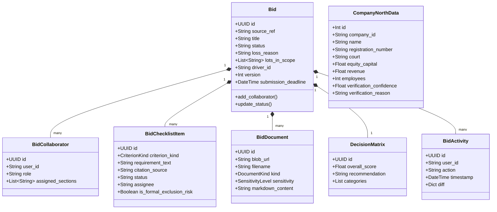
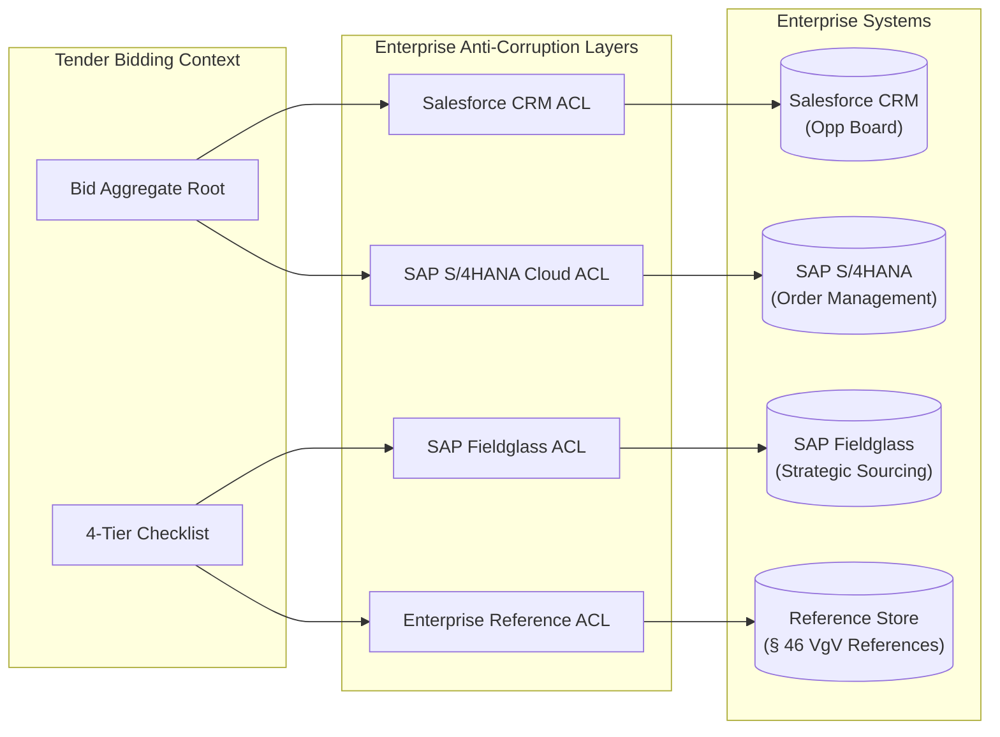

# 🧠 Domain Model: Tender Bidding

> **Context Type:** Core Domain (Proposal Authoring, Sourcing & Integration ACL)  
> **Sovereignty:** Dedicated Database (`BIDDING_DATABASE_URL`) + Dedicated Azure Blob Storage  

---

## 1. Bounded Context Purpose

The **Tender Bidding Context** manages the collaborative preparation, qualification, and authoring of bids for public procurement tenders. It provides:
1. **Shipley Proposal Authoring**: Shreds RFP documents into an auditable **4-Tier Compliance Matrix** and synthesizes concepts using the **Feature-Benefit-Proof** framework.
2. **Enterprise Anti-Corruption Layers (ACLs)**: Bridges the Tender Tentacle core domain with enterprise systems:
   - **Salesforce CRM ACL**: Synchronizes sales stages and compiles the 1-page Management Summary for executive review.
   - **SAP S/4HANA Cloud ACL**: Verifies work package structures (*Kombinationstabelle*) and invoice descriptions.
   - **SAP Fieldglass ACL**: Sources contingent labor through pre-vetted Preferred Suppliers while strictly enforcing **§ 7a SGB IV Anti-Scheinselbstständigkeit**.
3. **North Data Partner Intelligence**: Evaluates commercial register filings, financial viability, and beneficial ownership for consortium partners.
4. **GDPR Special-Category Data Isolation**: Isolates sensitive employee CVs and company filings on a dedicated database and encrypted blob store.

---

## 2. 🧱 Entities & Aggregates

### `Bid` (Aggregate Root)
The primary orchestrator of a tender pursuit.
- **Identity**: `id` (UUID), `source_ref` (unique reference mirrored from the upstream Enriching external ID or group ID).
- **Concurrency & Versioning**: `version` integer incremented on every state transition. Stale mutations return `409 Conflict`.
- **Status Lifecycle**: `draft` $\rightarrow$ `in_review` $\rightarrow$ `submitted` $\rightarrow$ `won` | `lost` | `archived`.
- **Win/Loss Loop**: Any transition to `lost` strictly mandates recording a `loss_reason` (`formal`, `price`, `quality`, `reference_gap`, `other`).

### `BidChecklistItem` (Shipley 4-Tier Matrix Item)
Individual tender requirement extracted during automated RFP shredding:
- **Criterion Kinds**:
  - `formal` (*Formalkriterien*): Mandatory forms, submission channel compliance (Textform vs. QES), signatures. Drives the **Formal Pre-Flight Gate**.
  - `suitability` (*Eignungskriterien*): Turnover thresholds, corporate references (§ 46 VgV), and subcontractor teaming (*Eignungsleihe* § 47 VgV).
  - `concept` (*Leistungskriterien*): Technical concept chapters, methodology, and project management approaches.
  - `award` (*Zuschlagskriterien*): Pricing sheet, cost models, and economic operator evaluations.
- **Invariants**: Any unresolved `formal` requirement marked `is_formal_exclusion_risk = true` blocks bid submission.

### `CompanyNorthData`
Stores commercial register filings and financial health indicators for bidding partners and competitors:
- `company_id`: Canonical normalized corporate identifier.
- `registration_number`: Commercial register number (HRB / HRA).
- `court`: Competent registration court (*Amtsgericht*).
- `equity_capital`: Stated equity (*Eigenkapital*).
- `revenue`: Latest reported annual turnover.
- `employees`: Headcount metric.
- `verification_confidence`: Numerical similarity metric ($\ge 0.60$).
- `verification_reason`: Classification rationale (e.g. `VERIFIED_MATCH`).

### `BidDocument`
Represents tender documentation and submission deliverables:
- **Storage**: Raw files reside in Azure Blob Storage; text representations and metadata reside in SQL.
- **Sensitivity Classification**:
  - `normal`: Public tender notices and terms of reference.
  - `personal`: Standard consultant CVs and organizational charts.
  - `special`: GDPR Art. 9 special-category records (e.g. medical certificates, security clearance clearances, criminal record abstracts).

---

## 3. 🛡️ Enterprise Anti-Corruption Layers (ACLs)

The Bidding MS acts as the primary translation boundary between Tender Tentacle and enterprise back-office platforms:

### 1. Salesforce CRM ACL
- **Opportunity Board Management Summary**: Automatically compiles the 1-page executive brief for the weekly Opportunity Board, summarizing project scope, EMV, win probability ($P_{win}$), and competitive posture.
- **Pipeline Stage Synchronization**: Maps bid lifecycle states (`draft`, `in_review`, `submitted`) to Salesforce Opportunity stages.

### 2. SAP S/4HANA Cloud ACL
- **Kombinationstabelle Validation**: Verifies allowable work package pairings, billing unit types, and rate card consistency.
- **Invoice Service Descriptions**: Validates required text descriptions for milestone invoices.
- **Activities Abroad**: Provisions separate billing structures when work is delivered across international borders.

### 3. SAP Fieldglass ACL (Strategic Sourcing & § 7a SGB IV)
- **29 Preferred Suppliers**: Matches technical skill gaps against pre-approved vendor agreements to accelerate subcontractor onboarding.
- **Anti-Scheinselbstständigkeit Compliance**: Strictly forbids contracting solo freelancers (*Solo-Selbstständige*). Mandates contracting through registered corporate legal entities via Fieldglass.
- **Eignungsleihe Documentation (§ 47 VgV)**: Assembles legally binding commitment declarations (*Verpflichtungserklärungen*) confirming subcontractor capacity.

### 4. Enterprise Reference ACL
- Validates public sector references against § 46 VgV requirements and checks consultant availability against current project staffing.

---

## 4. 📖 Ubiquitous Language

| Term | German Equivalent | Definition |
| :--- | :--- | :--- |
| **Bid Workspace** | *Angebotsarbeitsraum* | The active collaborative project space coordinating proposal deliverables. |
| **Bid Driver** | *Angebotsverantwortlicher* | The lead bid specialist coordinating the pursuit across all lots. |
| **4-Tier Compliance Matrix** | *4-Stufen Kriterienmatrix* | Classification of all tender requirements into Formal, Suitability, Concept, and Award. |
| **Formal Pre-Flight Gate** | *Formale Ausschlussprüfung* | Rigorous audit ensuring zero formal defects before physical or electronic submission. |
| **Feature-Benefit-Proof** | *Nutzen-Vorteil-Beweis* | Shipley proposal narrative structure linking capabilities to client benefits with empirical proof. |
| **Eignungsleihe (§ 47 VgV)** | *Eignungsleihe* | Relying on the economic, financial, or technical capacity of partner entities or subcontractors. |
| **Anti-Scheinselbstständigkeit** | *§ 7a SGB IV Prüfung* | Legal obligation ensuring contingent labor is engaged through corporate entities rather than pseudo-self-employment. |
| **29 Preferred Suppliers** | *Bevorzugte Lieferanten* | Strategic vendor pool pre-cleared for contingent staff augmentation and sub-contracting. |
| **Kombinationstabelle** | *Kombinationstabelle* | SAP S/4HANA rules engine governing valid work package structures. |

---

## 5. 📝 Business Rules & Invariants

1. **Idempotent Snapshot Relay**:
   - The relay endpoint `POST /api/v1/internal/bids/relay` is idempotent on `source_ref`. Multiple relays update existing bids without duplicating workspaces.
2. **Strict Concurrency Control**:
   - Every bid mutation echoes the read `version`. Mismatches yield `409 Conflict`, requiring the client to reload state.
3. **Mandatory Win/Loss Capture**:
   - A bid cannot be marked `lost` without specifying an authoritative `loss_reason`.
4. **GDPR & Document Isolation**:
   - Original document binaries reside exclusively in Azure Blob Storage; SQL tables store only metadata and plain markdown representations.
   - Access is restricted per bid via `bid_collaborator` assignments.
5. **Zero Mock URLs**:
   - Attachment and document download endpoints never return simulated or mock URLs; missing documents resolve cleanly to `None`.
