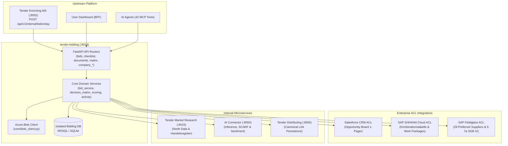

# 🤝 Tender Bidding Microservice

> **Domain Type:** Core Domain (Proposal Authoring, Sourcing & Integration ACL)  
> **Port:** 8014 (Docker Compose service: `bidding`)  
> **Data:** Isolated database (`BIDDING_DATABASE_URL`) + Azure Blob Storage (GDPR special-category documents)  
> **Ingress Gateway:** `/ms/bidding/...` (see `nginx/nginx.conf`)  

The **Tender Bidding Microservice** is the collaborative proposal authoring engine and enterprise integration backbone of the Tender Tentacle platform. It transforms tenders and lots triaged as actionable bids into an active **Bid Workspace**, orchestrating multi-pass RFP shredding, Shipley proposal drafting, enterprise system synchronization (Salesforce, SAP S/4HANA, SAP Fieldglass), and deep corporate partner vetting via North Data.

---

## 1. Overview & Key Capabilities

- **Shipley Proposal Authoring & 4-Tier Compliance Matrix**:
  - **Tier 1: Formal Pre-Flight Gate (*Formalkriterien*)**: Automated compliance verification for mandatory forms, submission channel compliance (Textform vs. Qualified Electronic Signature / QES), and mandatory declarations to eliminate the 10–15% formal rejection rate in public tenders.
  - **Tier 2: Suitability & Capacity (*Eignungskriterien*)**: Verification of corporate references (§ 46 VgV), turnover thresholds, and subcontractor teaming (*Eignungsleihe* § 47 VgV).
  - **Tier 3: Technical & Methodological Concepts (*Leistungskriterien*)**: Generative authoring of concept chapters using the Shipley **Feature-Benefit-Proof** framework.
  - **Tier 4: Award & Pricing Evaluation (*Zuschlagskriterien*)**: Multi-dimensional price sheet validation, economic operator scoring, and bid-to-budget alignment.
- **Enterprise Anti-Corruption Layers (ACLs)**:
  - **Salesforce CRM ACL**: Pre-fills Opportunity creation templates, compiles the 1-page **Management Summary** for the executive Opportunity Board, and synchronizes sales stages across the Lead-to-Order lifecycle.
  - **SAP S/4HANA Cloud ACL**: Validates work package combinations against the *Kombinationstabelle*, verifies the required `Service Description Invoice` text, and provisions country-specific work packages for *Activities Abroad*.
  - **SAP Fieldglass ACL**: Interfaces with Strategic Sourcing to query the organization's **29 Preferred Suppliers**, check rate-card ceilings, verify **§ 7a SGB IV Anti-Scheinselbstständigkeit** legal entity compliance, and assemble *Eignungsleihe* commitment letters.
  - **Enterprise Reference ACL**: Connects with enterprise project stores to assemble client-approved reference projects (§ 46 VgV) and verified consultant CVs.
- **North Data & Corporate Partner Integration**:
  - Direct integration with `tender-market-research` (`POST /api/v1/scrape/northdata`) to extract commercial register filings (Handelsregister HRB/HRA), registration courts, equity capital, annual revenue, and employee counts.
  - Computes entity verification confidence scores and classification reasons, storing validated records in `bid_company_northdata`.
- **Collaborative Workspace & Concurrency Control**:
  - Multi-user collaboration with designated **Bid Driver**, item assignees, and reviewers.
  - Optimistic concurrency control (version header returning `409 Conflict` on stale mutations).
  - Append-only `BidActivity` log functioning as the official audit log and GDPR access trail.
- **Document Sovereignty & GDPR Compliance**:
  - Segregates raw binary documents (stored securely in Azure Blob Storage) from extracted markdown and metadata stored in SQL.
  - Strict classification of documents by sensitivity level (`normal`, `personal`, `special` = GDPR Art. 9 special-category data).
- **Agentic MCP Server**: Exposes 42 Model Context Protocol (MCP) tools in `mcp/mcp_server.py`.

---

## 2. Architecture & Building Blocks



---

## 3. Technology Stack & Dependencies

| Component | Technology | Specification |
| :--- | :--- | :--- |
| **Runtime** | Python | 3.13 (`python:3.13-slim-bookworm`) |
| **Framework** | FastAPI / Starlette | Asynchronous REST API |
| **Database** | SQLite / Azure SQL | SQLAlchemy 2.0 (AsyncIO + aiosqlite / aioodbc) |
| **Object Storage** | Azure Blob Storage | Encrypted storage for original tender documents |
| **LLM Orchestration** | AI Connector | External client integration (`biddingms-aims-sentiment.json`) |
| **MCP Server** | Model Context Protocol | FastMCP / MCPServer standard (42 tools) |
| **Modes** | Real & Mock | Controlled via `BIDDING_MOCK=0` (real) or `BIDDING_MOCK=1` (mock) |

---

## 4. Local Setup & Execution

### Prerequisites
- Python 3.13+ installed
- Azure Blob Storage connection string (optional; falls back to local disk in mock mode)

### Installation

```bash
# Navigate to the service directory
cd tender-bidding

# Create and activate a virtual environment
python3.13 -m venv .venv
source .venv/bin/activate

# Install dependencies
pip install -r requirements.txt
```

### Environment Configuration

Configure the following environment variables (or provide via `.env` file):

```bash
# Database connection (isolated database per architecture standard)
DATABASE_URL="sqlite+aiosqlite:///./bidding.db"

# Operational mode: 0 for real mode (default), 1 for local mock mode
BIDDING_MOCK=0

# Azure Blob Storage for RFP documents
AZURE_STORAGE_CONNECTION_STRING="your-blob-connection-string"
AZURE_CONTAINER_NAME="tender-documents"

# Internal microservice dependencies
AI_URL="http://ai:8004"
MARKET_RESEARCH_URL="http://tender-market-research:8015"
DISTRIBUTING_URL="http://distributing:8005"
ENRICHING_URL="http://enriching:8002"
CRAWLING_URL="http://tender-crawling:8001"
```

### Running the Application

```bash
# Seed initial sample data (optional)
BIDDING_MOCK=1 python seed.py

# Start the service in real mode on port 8014
BIDDING_MOCK=0 python main.py

# Or via Uvicorn with auto-reload
uvicorn main:app --host 0.0.0.0 --port 8014 --reload
```

The service will be accessible at `http://localhost:8014` and through the ingress gateway under `/ms/bidding/...`.

### Running Tests

```bash
# Executes unit, integration, and pact tests in hermetic test environment
PYTHONPATH=. pytest tests/
```

---

## 5. Endpoints Overview

The service exposes 79 endpoints across 22 functional modules. For exhaustive schemas, consult [API.md](API.md).

| Module | Route Prefix | Key Capabilities |
| :--- | :--- | :--- |
| **Bids** | `/api/v1/bids` | Workspace CRUD, requirement enrichment, deadline tracking, collaborator management, portal guides. |
| **Checklist** | `/api/v1/bids/{bid_id}/checklist` | 4-tier requirement item updates, assignee allocation, verification state toggling. |
| **Comments** | `/api/v1/bids/{bid_id}/comments` | Collaborative commentary and audit discussion per bid. |
| **Decision Matrix** | `/api/v1/matrix` | Bid/No-Bid decision matrix scoring, evaluation history, and criteria overrides. |
| **Documents** | `/api/v1/documents` | Uploading and classification of tender documents (normal, personal, special). |
| **North Data** | `/api/v1/company/{id}/northdata` | Corporate register scraping, financial metrics, and verification confidence score. |
| **Company Mood** | `/api/v1/company/{id}/mood` | Kununu/Glassdoor reviews, SCARF model enrichment, and salary benchmarks. |
| **Company Jobs** | `/api/v1/company/{id}/jobs` | Job postings from Bundesagentur für Arbeit and Service.Bund.de. |
| **Subsidies & News**| `/api/v1/company/{id}/subsidies` | Public subsidy grants and news sentiment analysis. |
| **Handelsregister** | `/api/v1/company/{id}/handelsregister` | Commercial register extraction and insolvency filings. |
| **Internal Relay** | `/api/v1/internal/bids/relay` | Ingests snapshots from the Enriching MS when a tender is triaged as a bid. |

---

## 6. Model Context Protocol (MCP) Server

The microservice includes an embedded MCP server located at `mcp/mcp_server.py`, exposing 42 specialized tools for AI agent orchestration:
- **Bid Management**: `bidding_list_bids`, `bidding_get_bid`, `bidding_get_bid_by_source`, `bidding_extract_metadata`, `bidding_set_bid_status`, `bidding_regenerate_bid`.
- **Checklist & Collaboration**: `bidding_update_checklist_item`, `bidding_add_collaborator`, `bidding_add_bid_comment`, `bidding_get_bid_comments`, `bidding_get_bid_activity`.
- **Intelligence & Scoring**: `bidding_get_bid_score`, `bidding_get_bid_recommendation`, `bidding_get_bid_deadlines`, `bidding_get_portal_guide`, `bidding_get_matrix`, `bidding_run_matrix_evaluation`.
- **Company Intelligence**: `bidding_get_company_northdata`, `bidding_get_company_financials`, `bidding_get_company_handelsregister`, `bidding_get_company_mood`, `bidding_get_company_jobs`, `bidding_get_company_subsidies`, `bidding_get_company_summary`.

---

## 7. Governance & Standards

- **Role Responsibilities**:
  - **Bid Manager**: Leads the bid workspace, assigns checklist items, coordinates proposal drafting, and conducts formal pre-flight reviews.
  - **Strategic Sourcing Lead**: Governs SAP Fieldglass integrations, checks rate cards, and contracts external contingent labor through the 29 Preferred Suppliers.
  - **Opportunity Lead / Sales Director**: Reviews the Salesforce 1-page Management Summary at the Tuesday 9am Opportunity Board.
  - **Solution Architect**: Designs the work package Kombinationstabelle in SAP S/4HANA and verifies Eignungsleihe declarations (§ 47 VgV).
  - **Security Officer**: Ensures GDPR Art. 9 special-category documents in Azure Blob Storage have encrypted transit and strict per-bid collaborator access.
  - **Platform Lead & DevOps Team**: Governs database isolation (`BIDDING_DATABASE_URL`), connection pools, and zero-drift deployment across Docker and ACA.
- **Architectural Rules**:
  - Bid relay from Enriching is best-effort and idempotent on `source_ref`.
  - Zero mock URLs: attachment links point to authentic storage blobs or resolve cleanly to `None`.
  - Optimistic concurrency control is strictly enforced on all bid mutations.
