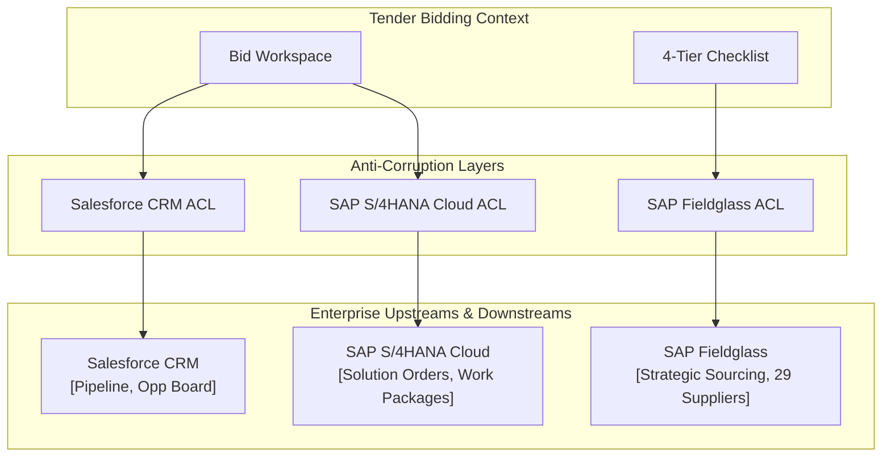

# 🤝 Interaction Contracts: Tender Bidding

> **Service:** Tender Bidding MS (`bidding:8014`)  
> **Role:** Consumer (of internal microservices & enterprise upstreams) & Provider (to Enriching MS and User Dashboard)  
> **Endpoint Inventory:** [../API.md](../API.md) — generated from FastAPI routers.  

---

## 1. As Provider

```mermaid
flowchart LR
    BID["tender-bidding\n(:8014)"]
    DASH["User Dashboard\n(BFF)"]
    ENR["tender-enriching\n(:8002)"]
    AGENTS["AI Agents\n(42 MCP Tools)"]

    BID -->|Bid State, Checklist, Matrix| DASH
    ENR -->|Bid Snapshot Relay| BID
    BID -->|MCP Tools (42)| AGENTS
```

### [Consumer] Tender Enriching MS (`enriching:8002`) — Bid Snapshot Relay
Enriching relays a complete tender snapshot when an opportunity is triaged as a `"bid"`.
- **Endpoint**: `POST /api/v1/internal/bids/relay`
- **Payload**: Full tender metadata, lots in scope, and already-shredded document markdown.
- **Idempotency**: Keyed on `source_ref` (Enriching `external_id` or group ID). Repeated relays update existing records without creating duplicate workspaces.
- **Resilience**: **Best effort** — if the Bidding MS is unreachable, upstream triage in Enriching still succeeds.

### [Consumer] User Dashboard (BFF) & Web UI
- **Concurrency Guarantee**: All bid-level mutations echo the read `version` number. Stale version submissions return **409 Conflict**, preventing concurrent overwrites.
- **Bid Resolution**: `GET /api/v1/bids/by-source/{source_ref}` returns the latest active bid workspace ordered by `version DESC, created_at DESC`.
- **Requirement Enrichment**: `POST /api/v1/bids/enrich` provisions the 4-tier compliance checklist, supporting `source_id` alias fallback.
- **North Data Scrape**: `POST /api/v1/company/{company_id}/northdata/scrape` invokes Market Research MS, updates Distributing MS with the canonical URL, and returns `CompanyNorthDataSchema` with `verification_confidence` and `verification_reason`.
- **Employee Culture & Mood**: `GET /api/v1/company/{company_id}/mood` auto-syncs from Market Research MS on cache miss and returns sanitized reviews.
- **SCARF Enrichment**: `POST /api/v1/company/{company_id}/enrich-mood-scarf` computes SCARF metrics via the AI Connector and returns dimension scores.
- **Pact Contract**: `pacts/userdashboard-biddingms-northdata.json`.

---

## 2. Enterprise Anti-Corruption Layer (ACL) Contracts

The Bidding MS acts as the primary Anti-Corruption Layer (ACL) translating core platform concepts into enterprise systems:



### 1. Salesforce CRM ACL (`SalesforceOpportunityDTO`)
Translates bid qualifications and financial models into Salesforce CRM objects:
- **Opportunity Pre-Fill**: Generates pre-populated opportunity records with client identifiers, procurement numbers, and submission deadlines.
- **Management Summary (1-Pager)**: Synthesizes a structured 1-page executive briefing for the weekly Tuesday 9am Opportunity Board:
  - `opportunity_name`: Title and procurement authority.
  - `budget_ceiling`: Stated or estimated contract value.
  - `calibrated_pwin`: Calibrated win probability from Scoring MS ($P_{win}$).
  - `expected_monetary_value`: EMV calculation ($Budget \times P_{win}$).
  - `competitive_differentiators`: Key Shipley discriminators and teaming advantages.
  - `risk_assessment`: Formal and legal risks (§ 47 VgV, capacity gaps).
- **Stage Synchronization**: Bi-directionally maps bid states (`draft`, `in_review`, `submitted`, `won`, `lost`) to CRM stages.

### 2. SAP S/4HANA Cloud ACL (`SolutionOrderWorkPackageDTO`)
Validates commercial delivery and billing structures prior to contract signature:
- **Kombinationstabelle Validation**: Verifies that work package combinations, billing units (daily vs. hourly), and fee structures adhere to corporate rules.
- **Service Description Invoice**: Confirms that required invoice item texts meet public procurement audit standards.
- **Activities Abroad**: Automatically provisions country-specific work packages when delivery occurs outside Germany.

### 3. SAP Fieldglass ACL (`SourcingRequisitionDTO`)
Bridges tender capability gaps with strategic external workforce sourcing:
- **29 Preferred Suppliers**: Matches subcontracting skill gaps against the organization's pre-approved supplier pool to reduce staffing lead time.
- **Anti-Scheinselbstständigkeit (§ 7a SGB IV)**:
  - Strictly blocks solo freelancers (*Solo-Selbstständige*).
  - Enforces contracting through accredited legal entities (*Kapitalgesellschaften* / *Personengesellschaften*) registered in Fieldglass.
- **Eignungsleihe Commitment Letters (§ 47 VgV)**:
  - Assembles legally binding subcontractor commitment declarations (*Verpflichtungserklärungen*) required for public submission.

---

## 3. As Consumer of Internal Microservices

### [Provider] Tender Market Research MS (`MARKET_RESEARCH_URL:8015`)
- **North Data Scraper**: `POST /api/v1/scrape/northdata`
  - **Payload**: `{"query": company_id, "url": target_url}`
  - **Response**: `CompanyNorthDataSchema` with `company_name`, `court`, `registration_number`, `equity_capital`, `revenue_latest`, `employees_count`, `source_url`, `verification_confidence` (float $\ge 0.0$), and `verification_reason` (string).
- **Kununu Reviews**: `GET /api/v1/companies/by-name/{company_name}/kununu`
  - Ingests employee feedback for culture and SCARF evaluation.

### [Provider] AI Connector (`AI_URL:8004`)
- **Endpoints**: `POST /api/inference`, `POST /api/v1/enrich/scarf`
- **Contract**: Responses must include a non-null `result` string. Used for requirement extraction, pricing analysis, and SCARF model enrichment.
- **Pact Contract**: `pacts/biddingms-aims-sentiment.json`.

### [Provider] Tender Crawling MS (`CRAWLING_URL:8001`)
- **Endpoints**: Live registry and job scrapers (`/api/v1/scrape/handelsregister`, `/scrape/jobsuche`, `/scrape/servicebund_jobs`, `/scrape/insolvency`).
- **Timeout**: 15 seconds per call with graceful degradation on failure.

### [Provider] Tender Distributing MS (`DISTRIBUTING_URL:8005`)
- **Canonical Link Persistence**: `POST /api/v1/taxonomy/target_companies/by_name/{company_id}/links?link_type=NORTHDATA` updates master company links when verified.

---

## 4. Database Schema & Data Sovereignty

### Schema Governance
- **`bid_company_northdata` Table**:
  - `verification_confidence` (`FLOAT`): Confidence score from entity name similarity matching.
  - `verification_reason` (`VARCHAR(500)`): Explanation of verification outcome (`VERIFIED_MATCH` or rejection rationale).
  - Migrated automatically at boot via `core/database.py` (`ALTER TABLE ADD COLUMN` on SQLite, `IF COL_LENGTH() IS NULL` on MSSQL).

### GDPR Art. 9 & Security Guarantees
- **Data Isolation**: This service operates on its own dedicated database server (`BIDDING_DATABASE_URL`).
- **Object Storage**: Original RFP documents reside exclusively in Azure Blob Storage. Database records store only extracted markdown text and metadata.
- **Access Restrictions**: Multi-tenancy access is governed per bid via `bid_collaborator`. No tenant-wide read permissions exist.
- **Audit Trails**: Every mutation appends to `bid_activity`, fulfilling GDPR Art. 15/30 access logging requirements.
- **Zero Mock URLs**: Document links never produce simulated or mock endpoints; missing documents resolve strictly to `None`.
