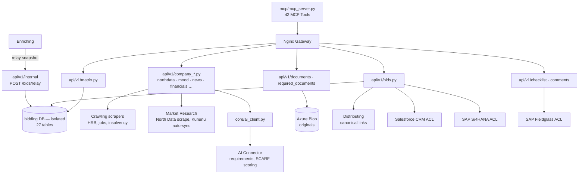
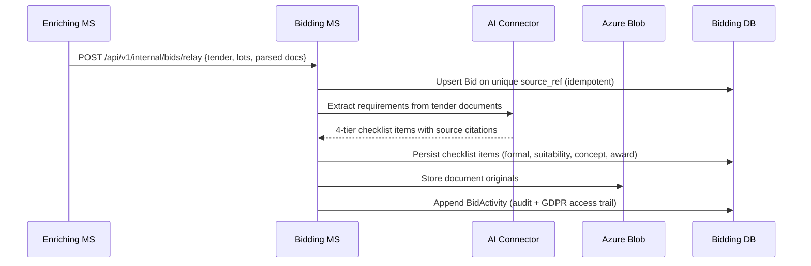
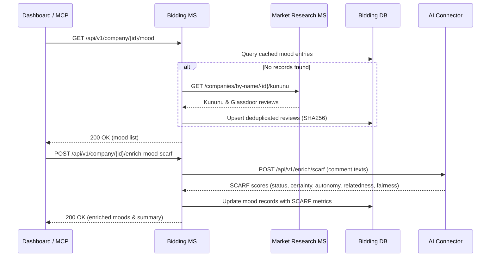

# Microservice Architecture: Tender Bidding

## 1. Introduction and Goals
*   **Purpose**: Turn a tender triaged as a *bid* into a collaborative **Bid Workspace** — orchestrating Shipley proposal authoring, a 4-tier source-cited compliance checklist, enterprise integrations (Salesforce, SAP S/4HANA, SAP Fieldglass), deadline tracking, and an isolated document repository.
*   **Quality Goals**:
    *   **Zero Formal Defect Exclusions**: 10–15% of public bids fail on formal grounds; the **Formal Pre-Flight Gate** strictly blocks defective submissions.
    *   **Enterprise Boundary Integrity**: Robust Anti-Corruption Layers (ACLs) connecting with Salesforce CRM, SAP S/4HANA, and SAP Fieldglass without polluting the core domain.
    *   **GDPR Art. 9 Data Isolation**: Secure storage of special-category documents on a dedicated database and encrypted Azure Blob storage.
    *   **Concurrency & Data Integrity**: Optimistic concurrency control (409 Conflict) and zero mock data fallbacks.

## 2. Context and Scope
*   **Domain Boundary**: Core domain — Proposal Authoring, Sourcing & Integration ACL. Upstream is Enriching via an Anti-Corruption Layer (a snapshot is copied in, never a shared database).
*   **Inbound**:
    *   Enriching (`POST /api/v1/internal/bids/relay` when `triage_status` becomes `"bid"`, best-effort).
    *   Nginx Gateway (`/ms/bidding/...`) / User Dashboard BFF.
    *   **42 MCP Tools** (`mcp/mcp_server.py`) for AI agent automation.
*   **Outbound**:
    *   AI Connector (`AI_URL`) for requirement extraction and SCARF analysis.
    *   Market Research MS (`MARKET_RESEARCH_URL`) for North Data entity verification and Kununu reviews.
    *   Distributing MS (`DISTRIBUTING_URL`) for canonical company link persistence.
    *   Crawling MS (`CRAWLING_URL`) for live registry and job scrapers.
    *   Salesforce CRM (Opportunity Board 1-pager summary).
    *   SAP S/4HANA Cloud (Kombinationstabelle work package validation).
    *   SAP Fieldglass (29 Preferred Suppliers & § 7a SGB IV anti-Scheinselbstständigkeit compliance).

## 3. Solution Strategy
*   **Shipley 4-Tier Compliance Matrix**: Requirements are shredded into `formal` / `suitability` / `concept` / `award`. Concept sections leverage the **Feature-Benefit-Proof** framework.
*   **Documents Split by Storage Class**: Raw binaries reside in Azure Blob Storage; markdown renderings and metadata reside in SQL. Classified by `kind` and `sensitivity` (`normal` / `personal` / `special`).
*   **Enterprise Anti-Corruption Layers (ACLs)**:
    *   *Salesforce CRM ACL*: Compiles the 1-page Management Summary for the Tuesday 9am Opportunity Board.
    *   *SAP S/4HANA Cloud ACL*: Validates work package combinations against the *Kombinationstabelle*.
    *   *SAP Fieldglass ACL*: Matches tender skill gaps with the organization's **29 Preferred Suppliers** and enforces **§ 7a SGB IV** corporate contracting.
*   **Optimistic Concurrency**: Bid-level mutations carry the read `version`; mismatches return **409 Conflict**.
*   **Idempotent Relay**: `source_ref` (Enriching external ID / group ID) is unique; repeated relays update without duplication.
*   **Autonomous Intelligence Auto-Sync**: Automatically pulls and synchronizes employer reviews from Market Research MS on local cache misses.
*   **North Data Entity Verification**: Delegates corporate scraping to Market Research MS (`POST /api/v1/scrape/northdata`), persisting confidence scores and verification reasons in `bid_company_northdata`.
*   **Zero Mock Data Integrity**: Unlinked documents return explicit `None` rather than fabricated mock endpoints.

## 4. Building Block View

## 5. Runtime View

### Relay → Workspace Provisioning

### Review Auto-Sync & SCARF Enrichment

## 6. API Contracts
*   **Endpoint Reference**: [../../API.md](../../API.md) — 79 endpoints under the canonical `/api/v1` prefix.
*   **Contracts**: [../CONTRACTS.md](../CONTRACTS.md); Pact files `pacts/biddingms-aims-sentiment.json` and `pacts/userdashboard-biddingms-northdata.json`.
*   **Agent MCP Server**: [../../mcp/mcp_server.py](../../mcp/mcp_server.py) — 42 tools exposing bid state, checklists, matrix evaluation, and company intelligence.

## 7. Data Storage
*   **Engine**: Dedicated database instance configured via `BIDDING_DATABASE_URL` (MSSQL in production, SQLite in local dev) ensuring data isolation for personal and special-category data.
*   **Schema**: 27 `bid*` tables — `bid` (aggregate root), `bid_checklist_item`, `bid_document`, `bid_collaborator`, `bid_comment`, `bid_activity`, `bid_category_rating`, and `bid_company_*` cache tables.
*   **Recent Schema Additions**:
    *   `bid_company_northdata.verification_confidence` (`FLOAT`): Match confidence from entity verification.
    *   `bid_company_northdata.verification_reason` (`NVARCHAR(500)`): Explanation for verification state.
    *   Automated non-destructive migrations in `core/database.py`.
*   **Blob**: Original document binaries reside in Azure Blob Storage; SQL holds only markdown text and metadata.

## 8. Deployment View
*   **Container**: Standardized container with `python:3.13-slim-bookworm`, Uvicorn on **8014**.
*   **Compose Service**: `bidding`; gateway prefix `/ms/bidding/`.
*   **Runtime Environment**: Python 3.13 standardized across Docker and local execution.
